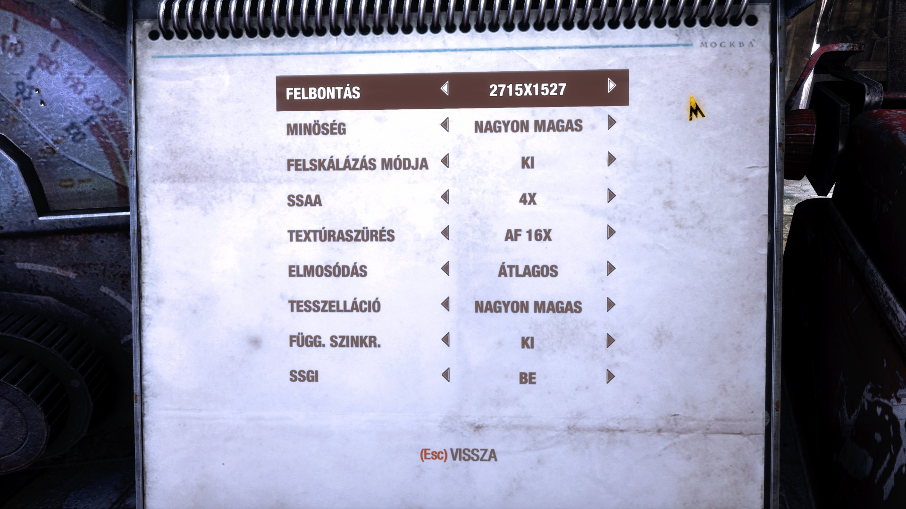
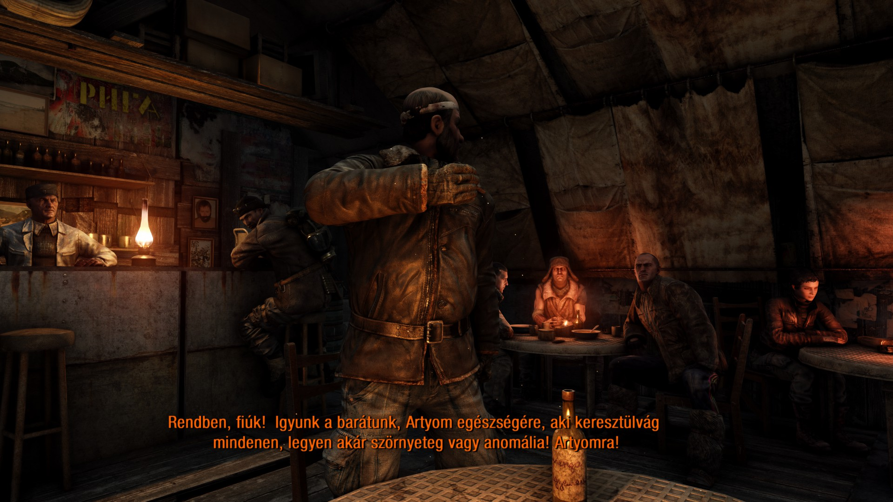

# Metro 2033 Redux Next-Gen – Magyarítás

Nem hivatalos magyarítás a **Metro 2033 Redux Steam next-gen Windows-kiadásához**. Magyar menük és feliratok, az új szövegek fordításával. A fegyvernevek eredeti angol alakban szerepelnek.

A telepítő külön választható összetevőként a főmenü reklámpaneljét is elrejtheti, magyarítás nélkül is. Ezzel a PROS-fiók QR-kódja és a PROS-fiókhoz kapcsolás sem érhető el. Az opció alapból ki van kapcsolva.

**Letöltés:** [Kiadások / Releases](https://github.com/Harciropi/metro_2033_redux_nextgen_HUN/releases)

## Telepítés

**Az eredeti magyarítás külön telepítése nem szükséges.** Ez a telepítő minden szükséges magyar nyelvi fájlt tartalmaz; közvetlenül a játékhoz telepítsd.

1. Zárd be a játékot.
2. Indítsd el a `Metro2033Redux_NextGen_HU.exe` fájlt.
3. Ellenőrizd a helyi Steam-adatokból felismert játékmappát, vagy tallózd be kézzel. Válaszd ki a kívánt összetevőket, majd telepítsd őket.
4. A magyarítás használatakor a játékban válaszd az **angol szövegnyelvet** – a menük és feliratok magyarul jelennek meg.

**Módosítás és eltávolítás:** indítsd el újra ugyanazt az EXE-t. Az összetevők külön ki- és bekapcsolhatók, vagy a teljes eltávolítás is választható. A telepítő visszaállítja a mentett eredeti fájlokat; sikeres teljes eltávolításkor saját mentéseit is törli. A játékmentések és beállítások megmaradnak. Egy későbbi játékfrissítés után újabb javításra lehet szükség.

## Képernyőképek

## Készítők

- **Eredeti magyarítás:** [Lostprophet](https://lostprophet.hu/) – [eredeti letöltés](https://magyaritasok.hu/download/2181/metro-2033-redux).
- **Next-gen kiegészítő fordítás és telepítő:** [Harciropi](https://github.com/Harciropi).

A játék, az eredeti fordítás és a Steam-grafikák jogai a megfelelő jogosultakat illetik. Ez egy nem hivatalos, közösségi projekt.
